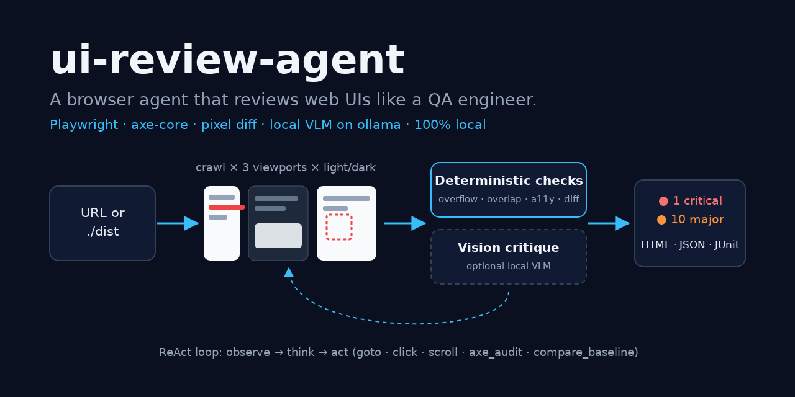
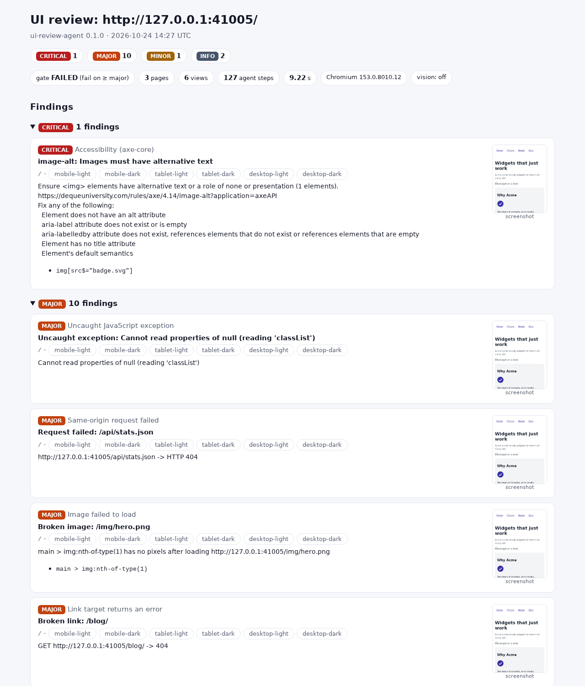
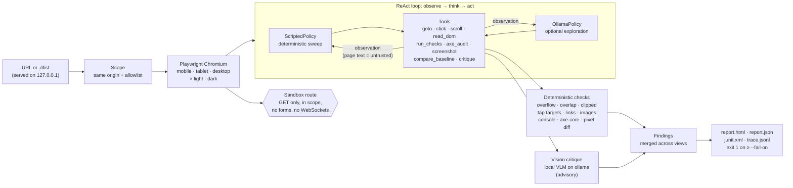

# ui-review-agent

> A browser agent that reviews web UIs like a QA engineer: it crawls your site in headless
> Chromium, screenshots every page on mobile, tablet and desktop in light and dark mode,
> finds layout, accessibility and visual-regression bugs with deterministic checks first
> and an optional local vision model second, and fails your CI with an HTML, JSON and
> JUnit report.

[](https://github.com/MartinCastroAlvarez/ui-review-agent/actions/workflows/ci.yml)
[](LICENSE)
[](pyproject.toml)
[](pyproject.toml)



Point `ui-review` at a URL or a static build folder. It drives Playwright through a
ReAct loop (observe → think → act) with tools like `goto`, `click`, `scroll`,
`read_dom`, `axe_audit` and `compare_baseline`, and reports every problem with a
selector, a screenshot and the views it shows up in.

**Runs 100% locally, no paid APIs required.** The browser is Playwright's Chromium, the
accessibility rules are axe-core, the optional vision critic is an open-weight model on
[ollama](https://ollama.com). No telemetry, no keys.

## Why

- **Screenshots alone don't find bugs; people looking at them do.** The agent does the
  looking: it measures overflow, overlapping and clipped text, tap targets, contrast and
  broken assets in every viewport and color scheme, so dark-mode and phone-only bugs
  show up before users find them.
- **Deterministic before generative.** Cheap DOM-geometry checks, axe-core and pixel
  diffs catch most UI bugs without a model, are repeatable, and gate CI. A local VLM
  then looks for what rules can't express, and stays advisory.
- **Safe to point at a real site.** It only sends `GET`s: forms are never submitted,
  writes, beacons and WebSockets are blocked in the browser, and it never leaves the
  site's origin unless you allow a host.
- **Made for CI.** Exit code 1 on findings at or above `--fail-on`, JUnit XML for test
  reporters, a self-contained HTML report as an artifact, baselines you commit.

## Quickstart

```bash
pip install "ui-review-agent @ git+https://github.com/MartinCastroAlvarez/ui-review-agent"
playwright install --with-deps --only-shell chromium
ui-review https://staging.example.com          # or a build folder: ui-review ./dist
open ui-review-report/report.html
ollama pull qwen2.5vl:7b                        # optional: vision critique, picked up automatically
```

Try it on the bundled demo site, which has eleven deliberate bugs
([`examples/site/README.md`](examples/site/README.md)). Real output, with the repeated
view lists shortened:

```text
$ ui-review examples/site
  [critical] a11y              image-alt: Images must have alternative text  (mobile-light, mobile-dark, tablet-light, tablet-dark, desktop-light, desktop-dark)
  [major   ] page-error        Uncaught exception: Cannot read properties of null (reading 'classList')  (… all six views)
  [major   ] failed-request    Request failed: /api/stats.json  (… all six views)
  [major   ] broken-image      Broken image: /img/hero.png  (… all six views)
  [major   ] broken-link       Broken link: /blog/  (… all six views)
  [major   ] overflow          Page scrolls horizontally  (mobile-light, mobile-dark)
  [major   ] overlap           Text overlaps other text  (… all six views)
  [major   ] tap-target        Tap target smaller than 24 px  (mobile-light, mobile-dark, tablet-light, tablet-dark)
  [major   ] tap-target        Tap target smaller than 24 px  (mobile-light, mobile-dark, tablet-light, tablet-dark)
  [major   ] a11y              color-contrast: Elements must meet minimum color contrast ratio thresholds  (mobile-dark, tablet-dark, desktop-dark)
  [major   ] a11y              color-contrast: Elements must meet minimum color contrast ratio thresholds  (mobile-dark, tablet-dark, desktop-dark)
  [minor   ] clipped-text      Text is cut off by its container  (… all six views)
FAIL: 3 pages, 1 critical, 10 major, 1 minor, 2 info. Report: ui-review-report/report.html
```

3 pages × 6 views in about 9 seconds (127 agent steps). The two `info` findings are
the sandbox at work: the site's `sendBeacon` POST and an off-site tracking pixel were
blocked. The HTML report:



## How it works



1. **Crawl.** Breadth-first over same-origin links (`--max-pages`, `--max-depth`); a
   local folder is served on loopback so it behaves like the deployed site.
2. **Sweep.** For each page and each of the six views, the scripted policy runs
   `goto → scroll → read_dom → run_checks → axe_audit → screenshot → compare_baseline →
   critique`, writing a thought for every step to `trace.jsonl`.
3. **Check.** Geometry checks run in the page (`ui_review/js/dom_checks.js`), axe-core
   4.14 is injected for WCAG 2.2 A/AA, screenshots are diffed against baselines with a
   per-channel tolerance and a perceptual hash, and network/console events are collected
   per view. See [`ARCHITECTURE.md`](ARCHITECTURE.md) for each check's exact rule.
4. **Explore (optional).** `--explore 20` hands the same tools to a local tool-calling
   model (`qwen3:8b` by default) to open menus, tabs and dialogs the sweep can't reach.
5. **Critique (optional).** With a vision model pulled, each screenshot is reviewed
   against a QA rubric. Its findings are capped at `minor`, so the gate rests on
   deterministic evidence.
6. **Report.** Findings merge across views, are grouped by severity, and carry
   selectors, screenshots and diff images.

### Visual regression

```bash
ui-review ./dist --baseline .ui-review/baseline --update-baseline   # on main: record
ui-review ./dist --baseline .ui-review/baseline                     # on PRs: compare
```

A view is a regression when more than `--max-diff` (0.1 %) of pixels differ by more than
`--tolerance` (16/255) on any channel, or the page size changed. Size changes and large
perceptual-hash distances are `major`, small pixel drift `minor`. Diff images (changes in
red over the faded page) are linked from the report.

### In CI

[`examples/github-action.yml`](examples/github-action.yml) builds a site, runs the review
on GitHub-hosted runners and uploads the report. This repository's own CI reviews the
demo site on every push and asserts every bug is found.

## Configuration

Flags override environment variables; everything is optional.

| Flag | Env | Default | Meaning |
| --- | --- | --- | --- |
| `target` | | | URL (`http`/`https`) or a static build directory/file |
| `-o, --out` | | `ui-review-report` | report directory |
| `--viewports` | | `mobile,tablet,desktop` | 390×844 touch, 768×1024 touch, 1280×800 |
| `--schemes` | | `light,dark` | `prefers-color-scheme` per view |
| `--max-pages` | `UI_REVIEW_MAX_PAGES` | `10` | crawl budget |
| `--max-depth` | | `3` | link depth from the start page |
| `--allow-host` | | none | extra host the browser may load (`cdn.example.com`, `*.example.com`) |
| `--baseline` / `--update-baseline` | | off | baseline directory / record the current run |
| `--tolerance` / `--max-diff` | | `16` / `0.001` | per-channel tolerance / changed-pixel ratio |
| `--no-axe` / `--no-links` | | | skip the axe audit / the link check |
| `--vision` | `UI_REVIEW_VISION` | `auto` | `auto` (on if the model is pulled), `on` (required), `off` |
| `--vision-model` | `UI_REVIEW_VISION_MODEL` | `qwen2.5vl:7b` | any ollama vision model (`llava`, `gemma3`, …) |
| `--explore` | `UI_REVIEW_EXPLORE_STEPS` | `0` | LLM exploration steps after the sweep |
| `--agent-model` | `UI_REVIEW_AGENT_MODEL` | `qwen3:8b` | ollama tool-calling model |
| `--fail-on` | | `major` | lowest severity that makes the exit code 1 |
| | `OLLAMA_HOST` | `http://127.0.0.1:11434` | must be loopback… |
| | `UI_REVIEW_ALLOW_REMOTE_OLLAMA` | `0` | …unless this is `1` |
| | `UI_REVIEW_CHROMIUM_PATH` | Playwright's | another Chromium / headless-shell binary |
| | `UI_REVIEW_CDP_URL` | none | attach to a running Chromium over CDP (loopback only) |
| | `UI_REVIEW_CHROMIUM_ARGS` | `--disable-dev-shm-usage` | extra browser flags |

Exit codes: `0` passed, `1` findings at or above `--fail-on`, `2` usage or setup error.

## Security

The review is read-only by construction: the browser route aborts every non-`GET` and
every off-scope request, form submission is cancelled in the page, WebSockets are never
connected, and tests assert that a recording server only ever sees `GET`s. Page content
reaches models only as escaped, delimited untrusted data, and the HTML report contains
no script. Details and the threat model: [`SECURITY.md`](SECURITY.md).

## Testing

```bash
poetry install
poetry run playwright install --with-deps --only-shell chromium
UI_REVIEW_REQUIRE_BROWSER=1 poetry run pytest
```

98 tests, 96 % coverage. Browser tests use real headless Chromium against local servers,
including the demo site (every bug found on the right viewports, no false positives on
the clean parts), sandbox attacks (POST/DELETE `fetch`, `sendBeacon`, `form.submit()`,
Enter-to-submit, WebSockets, pop-ups, `alert`, off-site exfiltration), baseline →
regression → re-baseline, and the vision and exploration phases against a fake ollama
(`httpx.MockTransport`). No network, no real model. Without a browser the browser tests
skip locally; CI sets `UI_REVIEW_REQUIRE_BROWSER=1` so they can't.

## Part of the series

| Series | Repositories |
| --- | --- |
| Apps | [local-rag-ollama](https://github.com/MartinCastroAlvarez/local-rag-ollama) · **ui-review-agent** |
| Agent tooling | [agent-lint](https://github.com/MartinCastroAlvarez/agent-lint) · [repo-graph-mcp](https://github.com/MartinCastroAlvarez/repo-graph-mcp) · [s3-agent-memory](https://github.com/MartinCastroAlvarez/s3-agent-memory) · [pytest-llm-evals](https://github.com/MartinCastroAlvarez/pytest-llm-evals) · [serverless-mcp-aws](https://github.com/MartinCastroAlvarez/serverless-mcp-aws) · [agent-model-router](https://github.com/MartinCastroAlvarez/agent-model-router) |
| Django admin family | [django-admin-react](https://github.com/MartinCastroAlvarez/django-admin-react) · [django-admin-rest-api](https://github.com/MartinCastroAlvarez/django-admin-rest-api) · [django-admin-mcp-api](https://github.com/MartinCastroAlvarez/django-admin-mcp-api) · [django-admin-graph](https://github.com/MartinCastroAlvarez/django-admin-graph) · [django-admin-skills](https://github.com/MartinCastroAlvarez/django-admin-skills) |
| Patterns catalog | [agentic-architectures](https://github.com/MartinCastroAlvarez/agentic-architectures): every agent pattern, linking the LangGraph, ADK, CrewAI and LangChain repos |

## Contributing

See [`CONTRIBUTING.md`](CONTRIBUTING.md), [`ARCHITECTURE.md`](ARCHITECTURE.md),
[`SECURITY.md`](SECURITY.md) and the agent contract in [`CLAUDE.md`](CLAUDE.md).

## License

MIT © 2026 Martín Castro Álvarez. See [LICENSE](LICENSE). Bundles
[axe-core](https://github.com/dequelabs/axe-core) 4.14.0 unmodified under the Mozilla
Public License 2.0 ([`ui_review/vendor/`](ui_review/vendor/README.md)).
